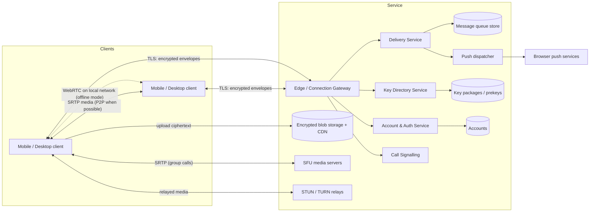

# 03 — System Architecture

**Status:** Draft — technology-agnostic. Concrete choices live in ADRs.

## 1. Guiding principles

1. **Smart clients, dumb server.** All encryption, decryption, rendering,
   search, thumbnailing and link previews happen on the client. The server
   routes opaque ciphertext.
2. **One protocol core, many transports.** The same encrypted message
   envelope travels over the internet (server), Bluetooth, or Wi-Fi Direct.
   Transport is a pluggable layer beneath the crypto.
3. **Shared core library.** Protocol, crypto, storage and sync logic live in
   one cross-platform library so iOS/Android/desktop cannot diverge in
   security-critical behaviour.
4. **Minimise metadata.** Every stored field must justify its existence.

## 2. Context diagram



## 3. Client architecture (web / PWA first)

```
┌──────────────────────────── Main thread ───────────────────────────┐
│ UI: TypeScript + React (ADR-0004)                                  │
│ Media: WebRTC (getUserMedia, RTCPeerConnection), MapLibre GL       │
├────────────────────────────────────────────────────────────────────┤
│ Core worker (Dedicated/Shared Worker)                              │
│  CORE LIBRARY: Rust compiled to WASM (ADR-0003)                    │
│   • Identity & device keys       • MLS engine (OpenMLS)            │
│   • Message model & sync         • Attachment crypto               │
│   • Envelope codec (protobuf)    • Mesh routing (offline)          │
│   • Encrypted local DB: SQLite-WASM on OPFS                        │
│   • Transport abstraction ──────────┬──────────────┬───────────────│
├─────────────────────────────────────┼──────────────┼───────────────┤
│ WebSocket to server                 │ WebRTC data  │ (native only) │
│                                     │ channels on  │ BLE / Wi-Fi   │
│                                     │ local network│ Aware plugins │
├─────────────────────────────────────┴──────────────┴───────────────┤
│ Service worker: app-shell cache, Web Push handling, update gating  │
└────────────────────────────────────────────────────────────────────┘
```

- The **core runs in a worker**, so crypto and DB work never block the UI
  and keys stay out of the main thread's reach as far as the platform allows.
- **SFrame for calls** runs in an `RTCRtpScriptTransform` worker (Safari,
  Firefox) or via encoded insertable streams (Chromium), keyed from the core.
- The **same Rust core** builds for native wrappers later (UniFFI bindings
  for Swift/Kotlin, or a Tauri/Capacitor bridge), so security-critical code
  is written once.
- The E2EE engine **does not know which transport** carries an envelope.
  Offline mode is a different transport plus a different ordering strategy
  (doc 07), not a separate app.

### Browser storage constraints
- Storage can be evicted (especially Safari when the site isn't installed
  and unused for 7 days). Mitigations: prompt install, request persistent
  storage, linked-device sync, encrypted backup (FR-MSG-13).
- Local DB encrypted with a key that is itself wrapped by a
  **non-extractable WebCrypto AES-GCM key** in IndexedDB, plus an optional
  passphrase.

## 4. Server components

| Component | Responsibility | State |
|-----------|---------------|-------|
| Edge gateway | TLS termination, long-lived WebSocket connections, auth, rate limiting, routing to services | Stateless (connection registry in cache) |
| Account & auth | Phone verification (SMS/voice OTP via pluggable provider), device linking, auth tokens, account deletion | Accounts DB |
| Contact lookup | Rate-limited phone-number → account lookup | Accounts DB |
| Key directory | Publishes per-device public identity keys and one-time key packages/prekeys; optional key-transparency log | Key DB, append-only log |
| Delivery service | Accepts encrypted envelopes, fans out per recipient device, stores until acked, **orders group handshake messages** (required by MLS) | Message queue store |
| Group state service | Stores the *encrypted* group state / ordering epoch counter; never sees membership in plaintext if we adopt encrypted group metadata | Small KV |
| Blob service | Pre-signed upload/download URLs for encrypted attachments; TTL-based deletion | Object storage + CDN |
| Push dispatcher | Sends content-free or E2EE wake-ups via Web Push (VAPID, RFC 8291); APNs/FCM for native wrappers later | Push subscriptions |
| Call signalling | Relays encrypted SDP/ICE between peers; allocates SFU rooms | Ephemeral |
| SFU cluster | Forwards (does not decrypt) group-call media; simulcast layer selection | Ephemeral |
| STUN/TURN | NAT traversal and IP-hiding relay | Stateless |
| Abuse/reporting | Receives user reports with franking proofs | Reports DB |

## 5. Core data flows

### 5.1 Send a message (online)

1. Sender's core encrypts the payload for the conversation (group epoch key /
   pairwise ratchet) → produces an **envelope** `{conversation_id, epoch,
   ciphertext, sender_auth}`.
2. Client sends envelope to Gateway → Delivery Service.
3. Delivery Service durably stores one queue entry per recipient device, acks
   sender.
4. For each recipient device: if connected, push over its live connection;
   otherwise send a Web Push message.
5. Recipient fetches, decrypts, acks; Delivery Service deletes its entry.

### 5.2 Send media

1. Client generates random key K, encrypts file (streaming AEAD), hashes
   ciphertext.
2. Requests pre-signed upload URL, uploads ciphertext to Blob service.
3. Sends a normal E2EE message containing `{blob_id, K, hash, mime, size,
   encrypted thumbnail}`.
4. Recipient downloads ciphertext, verifies hash, decrypts with K.

### 5.3 Group membership change

1. Admin's client creates a protocol *commit* (adds/removes members, rotates
   group key).
2. Delivery Service accepts **exactly one commit per epoch** (first-wins
   ordering) and rejects conflicting ones; losers retry on the new epoch.
3. New members receive a *welcome* message encrypted to their key package.

### 5.4 Calls — see doc 05.  Offline — see doc 07.

## 6. Data model (server-side, indicative)

| Entity | Fields | Retention |
|--------|--------|-----------|
| Account | account_id, phone number (needed for login + SMS), created_at, auth credential | Until deletion |
| Device | device_id, account_id, identity public key, Web Push subscription, last_seen (coarse) | Until unlinked |
| KeyPackage | device_id, package bytes, expires_at | Until consumed/expired |
| QueuedEnvelope | recipient_device_id, envelope bytes, received_at | Until acked or 30 days |
| Blob | blob_id, size, expires_at | 30 days |
| GroupEpoch | group_id (opaque), current epoch, last commit hash | Life of group |

The server **does not** store: message content, conversation history, contact
lists, plaintext group names/members (goal), locations, call content.

## 7. Cross-cutting concerns

- **Protocol versioning:** every envelope carries a version; clients
  advertise supported versions in key packages.
- **Multi-device:** each device is an independent cryptographic member; a
  user = a set of devices. Self-sync of sent messages to own other devices goes
  through the same group/pairwise channel.
- **Observability:** metrics on queue depth, delivery latency, error rates;
  no per-user content or identifiers in logs.
- **Rate limiting & abuse:** per-account and per-IP token buckets at the edge;
  SMS-pumping protection (per-prefix limits, CAPTCHA/proof-of-work before
  sending a code, block premium-rate ranges).
- **Deployment:** every component ships as a container. Production runs
  on Kubernetes via a Helm chart (doc 10, ADR-0014); a Docker Compose file
  runs the full stack for local development.
