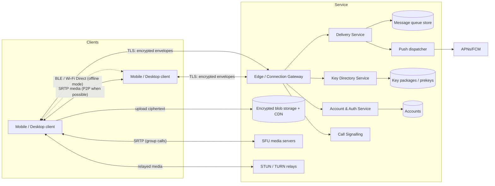

# 03 — System Architecture

**Status:** Draft — technology-agnostic. Concrete choices live in ADRs.

## 1. Guiding principles

1. **Smart clients, dumb server.** All encryption, decryption, rendering,
   search, thumbnailing and link previews happen on the client. The server
   routes opaque ciphertext.
2. **One protocol core, many transports.** The same encrypted message
   envelope travels over the internet (server), Bluetooth, or Wi-Fi Direct.
   Transport is a pluggable layer beneath the crypto.
3. **Shared core library.** Protocol, crypto, storage and sync logic live in
   one cross-platform library so iOS/Android/desktop cannot diverge in
   security-critical behaviour.
4. **Minimise metadata.** Every stored field must justify its existence.

## 2. Context diagram



## 3. Client architecture

```
┌────────────────────────────────────────────────────────┐
│ UI layer (platform-native or cross-platform toolkit)   │
├────────────────────────────────────────────────────────┤
│ App services: conversations, contacts, notifications,  │
│ media pipeline, call UI integration (CallKit/Telecom)  │
├────────────────────────────────────────────────────────┤
│ CORE LIBRARY (shared, cross-platform)                  │
│  • Identity & device keys      • E2EE protocol engine  │
│  • Message model & sync        • Attachment crypto     │
│  • Encrypted local DB          • Envelope codec        │
│  • Transport abstraction ──────┬──────────┬────────────│
├────────────────────────────────┼──────────┼────────────┤
│ Server transport (WS/QUIC)     │ BLE      │ Wi-Fi P2P  │
├────────────────────────────────┴──────────┴────────────┤
│ Real-time media engine (WebRTC-class) + frame E2EE     │
└────────────────────────────────────────────────────────┘
```

Key point: the **E2EE protocol engine does not know which transport** is
used. Offline mode is a different transport plus a different
ordering/consistency strategy (doc 07), not a separate app.

## 4. Server components

| Component | Responsibility | State |
|-----------|---------------|-------|
| Edge gateway | TLS termination, long-lived client connections (WebSocket or QUIC), auth, rate limiting, routing to services | Stateless (connection registry in cache) |
| Account & auth | Registration, device linking, auth tokens, account deletion | Accounts DB |
| Key directory | Publishes per-device public identity keys and one-time key packages/prekeys; optional key-transparency log | Key DB, append-only log |
| Delivery service | Accepts encrypted envelopes, fans out per recipient device, stores until acked, **orders group handshake messages** (required by MLS) | Message queue store |
| Group state service | Stores the *encrypted* group state / ordering epoch counter; never sees membership in plaintext if we adopt encrypted group metadata | Small KV |
| Blob service | Pre-signed upload/download URLs for encrypted attachments; TTL-based deletion | Object storage + CDN |
| Push dispatcher | Sends content-free wake-ups via APNs/FCM | Device push tokens |
| Call signalling | Relays encrypted SDP/ICE between peers; allocates SFU rooms | Ephemeral |
| SFU cluster | Forwards (does not decrypt) group-call media; simulcast layer selection | Ephemeral |
| STUN/TURN | NAT traversal and IP-hiding relay | Stateless |
| Abuse/reporting | Receives user reports with franking proofs | Reports DB |

## 5. Core data flows

### 5.1 Send a message (online)

1. Sender's core encrypts the payload for the conversation (group epoch key /
   pairwise ratchet) → produces an **envelope** `{conversation_id, epoch,
   ciphertext, sender_auth}`.
2. Client sends envelope to Gateway → Delivery Service.
3. Delivery Service durably stores one queue entry per recipient device, acks
   sender.
4. For each recipient device: if connected, push over its live connection;
   otherwise trigger content-free push notification.
5. Recipient fetches, decrypts, acks; Delivery Service deletes its entry.

### 5.2 Send media

1. Client generates random key K, encrypts file (streaming AEAD), hashes
   ciphertext.
2. Requests pre-signed upload URL, uploads ciphertext to Blob service.
3. Sends a normal E2EE message containing `{blob_id, K, hash, mime, size,
   encrypted thumbnail}`.
4. Recipient downloads ciphertext, verifies hash, decrypts with K.

### 5.3 Group membership change

1. Admin's client creates a protocol *commit* (adds/removes members, rotates
   group key).
2. Delivery Service accepts **exactly one commit per epoch** (first-wins
   ordering) and rejects conflicting ones; losers retry on the new epoch.
3. New members receive a *welcome* message encrypted to their key package.

### 5.4 Calls — see doc 05.  Offline — see doc 07.

## 6. Data model (server-side, indicative)

| Entity | Fields | Retention |
|--------|--------|-----------|
| Account | account_id, identifier hash, created_at, auth credential | Until deletion |
| Device | device_id, account_id, identity public key, push token, last_seen (coarse) | Until unlinked |
| KeyPackage | device_id, package bytes, expires_at | Until consumed/expired |
| QueuedEnvelope | recipient_device_id, envelope bytes, received_at | Until acked or 30 days |
| Blob | blob_id, size, expires_at | **[ASSUMPTION]** 30 days |
| GroupEpoch | group_id (opaque), current epoch, last commit hash | Life of group |

The server **does not** store: message content, conversation history, contact
lists, plaintext group names/members (goal), locations, call content.

## 7. Cross-cutting concerns

- **Protocol versioning:** every envelope carries a version; clients
  advertise supported versions in key packages.
- **Multi-device:** each device is an independent cryptographic member; a
  user = a set of devices. Self-sync of sent messages to own other devices goes
  through the same group/pairwise channel.
- **Observability:** metrics on queue depth, delivery latency, error rates;
  no per-user content or identifiers in logs.
- **Rate limiting & abuse:** per-account and per-IP token buckets at the edge;
  proof-of-work or attestation for registration (**open**).
